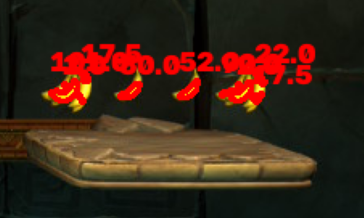
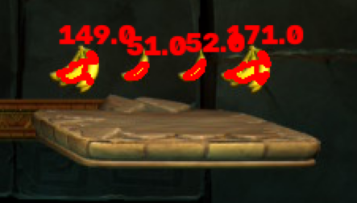
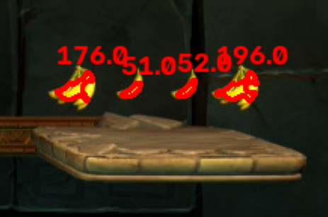

### Tok izrade:
> Ovo je dokumentovano razmisljanje tokom izrade ovog projekta. Jedna konstatacija vazi samo za taj trenutak i ne mora da znaci da je tacna u tom trenutku, jer je moguce da sam ispravio i nadogradio to.

Pretpostavka od koje sam krenuo:
- Pretvaranje u sivu
- Naglasavanje ivica objekata
- Segmentacija
- Morfolosko ciscenje (erozija, dilacija)

Prateci https://youtu.be/oXlwWbU8l2o?t=3426 dosao sam do pitanja da li ima razlike izmedju
Threshold i Canny (https://stackoverflow.com/questions/29322188/canny-edge-vs-thresholding-for-contour-estimation-in-open-cv).
Prvi korak je bio prebacivanje slike u sivu i naglasavanje ivica (Canny) kao priprema za segmentaciju.

Ivica je mjesto nagle promjene svjetline (izlaz Canny-ja), a kontura je lista tacaka, tj. piksela
koji leze na granici jednog bijelog regiona. Ako krenemo od jedne tacke i idemo po njima, obici cemo
cijeli region i vratiti se gdje smo krenuli. Bijeli region pravi threshold, a findContours vraca listu koordinata tacaka na granici tog regiona.

Canny sam izabrao jer banane i oblaci u sivoj slici imaju slicnu svjetlinu, pa sam ocekivao da
obican prag nece moci da ih razdvoji, a da ce Canny izdvojiti samo jake ivice. Kao sto je objasnjeno:

> "Canny Edge Detection obviously. It does a whole bunch of things to ensure that only strong edges come out of the result. Thresholding just takes a look at intensities and sees whether or not each value is smaller or larger and we get "edge" points respectively"

- Sa sivom slikom: mnogo banana se izgubi, jer pretvaranjem u sivu gubim boju,
  a zuta banana u sivom ima slicnu svjetlinu kao pozadina (nebo, trava), pa nema jaku ivicu.
  Iz ovoga zakljucujem da siva slika nije dobar ulaz, odnosno da mi treba informacija o boji.
- Bez sive slike: naglase se SVE ivice (lisce, trava, stabla), pa se banane
  izgube medju silnim konturama.

Zakljucak: Canny reaguje na promjene svjetline, a ne na boju. Kod ovih slika je boja jedino sto jasno izdvaja banane, pa segmentaciju radim po boji (HSV maska), a ne po ivicama.

Kod kojim sam testirao (prema gorenavedenom videu):
```python
import cv2 as cv
import numpy as np

img = cv.imread('data/images/image_1.jpg')
cv.imshow('img', img) # 3 kanala, cv.imread i cv.imshow rade u BGR - konverzija treba samo za matplotlib (RGB)
gray = cv.cvtColor(img, cv.COLOR_BGR2GRAY)
blank = np.zeros(img.shape, dtype='uint8')

# 1. nacin: Canny
blur = cv.GaussianBlur(gray, (5, 5), 0)
canny = cv.Canny(blur, 125, 175)
cv.imshow('Canny', canny) # 1 kanal, ovdje BGR ili RGB prikaz, nije bitno 

# 2. nacin: Threshold
ret, thresh = cv.threshold(gray, 125, 255, cv.THRESH_BINARY)
cv.imshow('Thresh', thresh)

# 1. nacin: proslijedimo canny kao prvi argument
# 2. nacin: proslijedimo thresh kao prvi argument
contours, hierarchies = cv.findContours(canny, cv.RETR_LIST, cv.CHAIN_APPROX_SIMPLE)
print(f'{len(contours)} contours found.')

cv.drawContours(blank, contours, -1, (0, 0, 255), 1)
cv.imshow('Contours Drawn', blank)

cv.waitKey(0)
cv.destroyAllWindows()
```

Kao sto je navedeno, boja mi je bitna. S tim u vezi, koristim HSV i maskiranje. U vjezbama 1 pise:

> Sve metode koje smo do sada radili rade nad grayscale slikom. Konverzija u grayscale je prvi korak, i već u njemu gubimo informaciju o boji. Ako nam je boja bitna, potreban nam je prostor boja u kojem je ona izdvojena kao posebna veličina.

Bijeli region pravi threshold (po svjetlini - da li si svjetliji od 125, ako jesi postajes bijel, ako nisi, postajes crn) ili HSV maska (po boji - da li je piksel boje izmedju donje i gornje, ako jeste, postaje bijel, ako nije, postaje crn). U oba slucaja izlaz je crna pozadina sa bijelim mrljama, samo je bolji HSV, jer on pita, da li je zuto, a ne da li je svijetlo.

Maska za HSV je slicno sto i Threshold za sivu sliku(ne bukvalno receno, razlike naravno ima, ali cisto radi sagledavanja sire slike).
BitwiseAnd radim da bi na stvarnoj slici gdje je bijelo ostala normalna boja, a gdje je crno, da bude crno. Tako se izdvajaju banane pomocu maske. 


Samo treba pogoditi zutu boju. Kako? 
Rjesenje sam potrazio ovdje:
Za svoj program sam izabrao Interactive Trackbar, kao na linku: https://medium.com/@sardorabdirayimov/lower-and-upper-mask-range-for-color-detection-opencv-7f64a5df568b

> AI je koristen za prilagodjavanje Trackbar-a u radu sa slikama.

```python
# maska ima 1 broj po pikselu (1 kanal), pa plt ne zna kojom bojom da ga prikaze - cmap mu kaze pravilo.
# Bez cmap se koristi podrazumijevana mapa (viridis): najmanji broj na slici - ljubicasta, srednji - zelena, najveci - zuta
# Sa cmap='gray': najmanji - crna, najveci - bijela, izmedju - nijanse sive
plt.imshow(mask, cmap='gray')
```
---

(Kasnije ce biti objasnjeno zasto ova morfoloska operacija nije bas pogodna.) <br>
Sto se tice morfoloskih operacija izabrana je erozija pa dilacija, takozvano, otvaranje. Erozija uklanja sum u vidu bijelih piksela, a dilacija stanjene banane vraca u normalno, sto i objasnjava zasto nije iskoristena samo erozija. Dilacija, normalno, nece biti koristena.

Otvaranje se primjenjuje na masku, tako da izmedju bitwise_and i kreiranja maske implementiram tu operaciju.

Kao na gorenapomenutom videu, koristicu findContours, da uporedim broj kontura(bijelih mrlja) prije i posle primjene otvaranja na masku.

Na svakoj slici je broj kontura otprilike pao za pola, tako da je otvaranje uradilo svoj posao.

RETR_EXTERNAL je koriscen za razliku od RETR_LIST jer RETR_LIST zapravo vraca rupe unutar kontura(novcic je odlican primjer, on ima unutrasnji krug, pa bi 1 objekat imao 2 konture), a RETR_EXTERNAL vraca samo spoljnje obrise.

CHAIN_APPROX_SIMPLE mi samo na pravolinijskim konturama ostavlja tacke preloma, ne cuva visak tacaka. Tako npr, pravougaonik odredjuju samo 4 tacke.

---

Tok rada(preuzeto sa vjezbi 1):
predobrada u vidu naglasavanja ivica ili eliminacije suma(opciono), segmentacija, morfolosko ciscenje i na kraju analiza povezanih komponenti pomocu
geometrijskih obiljezja (povrsina, obim, ...), na osnovu kojih se vrsi selekcija i klasifikacija.

Segmentaciju i ciscenje sam uradio, pa je sada na redu razlikovanje objekata: obicnih banana (1),
grozdova (5) i novcica (10). Logicno je da ih razlikujem po povrsini kontura.

findContours vraca dvije stvari:
- contours - niz kontura; svaka kontura je lista tacaka (x, y) na granici jednog bijelog regiona
- hierarchy - pokazuje da li je neka kontura unutar druge (roditelj-dijete); posto koristim
  RETR_EXTERNAL (samo spoljne konture), hijerarhija mi ne treba

Konture koje vraca findContours su uvijek zatvorene, pa cv.contourArea moze izracunati povrsinu
unutar njih.

Rezime pristupa:
- Canny daje ivice (linije), a ne popunjene regione, pa povrsina dobijenih kontura nema smisla(drugi razlog zasto ne koristim Canny).
- Threshold daje popunjene regione, ali po svjetlini, pa ne razdvaja banane od svijetle pozadine.
- HSV maska daje popunjene regione po boji. Nakon uklanjanja suma (otvaranje), findContours mi
  vraca zatvorene konture, koje cu klasifikovati na osnovu povrsine.

Kada sam poredao konture po povrsini, potrebno je potraziti koje konture bi pripadale sumu, novcicu, banani i grozdu.

Lakse bi bilo kada bih imao na slici broj povrsine iscrtan uz konturu, pa cu tekst i dodati(https://youtu.be/oXlwWbU8l2o?t=1221).

PROBLEM: Nakon iscrtavanja kontura, vidi se da ima dosta vise kontura ispisanih u terminalu nego sto ima vizuelno iscrtanih kontura(tehnicki su sve iscrtane samo su toliko blizu da se ne vide da su odvojene) sto moze znaciti da se u grozdovima racunaju banane pojedinacno, a to je otkriveno nakon iscrtavanja povrsina na konturama(vise povrsina odgovara jednom grozdu), to je problem kod racunanja povrsine. 
Opet, kad smo dosli do problema, mozemo se vratiti na masku i pogledati da je zapravo tu nastao problem. U samoj masci postoje tamniji dijelovi izmedju banana u grozdu, znaci problem ne mozemo rijesiti ako cemo mijenjati masku, vec je problem u narednim linijama koda. Tehnicki bismo mogli pomjeriti gornju i donju granicu zute boje, ali bi tada usli drugi objekti u masku, a to nam ne treba.

Za pronalazenje pozicije konture koristio sam link sa vjezbi(https://docs.opencv.org/5.0/py_tutorials/py_imgproc/py_contours/py_contour_features/py_contour_features.html): funkcija cv.boundingRect(c) koja trazi najmanji uspravni pravougaonik koji obuhvata cijelu konturu. Uspravni znaci da su mu stranice paralelne sa ivicama slike.

RJESENJE: jedina stvar koja moze biti da je ovo odradila jeste da je erozija otvaranja JOS VISE stanjila banane u grozdovima,a dilacija nije uspjela da 'popuni rupe', zato koristimo zatvaranje nakon otvaranja. Ovo se sve moze vidjeti da postoje rupe u grozdovima tako sto se plotuje maska.

IDEJA: U zatvaranju bi dilacija spojila dijelove grozda, a erozija bi vratila objekat na neku pribliznu normalnu velicinu.

Ne radim samo zatvaranje jer zatvaranje samo dodaje i spaja, sum bi se povecao, ne brise nista. Pa bi neko rjesenje bilo prvo otvaranje, pa onda zatvaranje da se spoje dijelovi grozda.

Ako koristim isti kernel(3,3) za zatvaranje, onda na slici 7 vidimo da se nije u potpunosti spojilo, i dalje imamo 2 povrsine za 1 grozd. Zato za zatvaranje koristim kernel(5,5). Kasnije (7,7) za bolje spajanje dijelova grozda.

Na slici image_7 je eksperimentisano:
<br>
Kernel(3,3)
<br>

<br>
Kernel(5,5)
<br>

<br>
Kernel(7,7)
<br>


---

Da bismo klasifikovali, pokrenucemo program nad nekoliko slika i zapisati povrsine, zatim gledati pragove i vidjeti gdje koji objekat pripada(sum, banane, grozdovi, novcici).

Gledajuci povrsine na razlicitim slikama(image_1 i image_8) nailazimo na problem.

Na slici 1, banane su povrsine od 170-210, a na slici 8 grozdovi znaju da budu velicine od 100-190. S tim u vezi, povrsina nije dovoljna, jer se opsezi preklapaju. Potreban je neki drugi parametar koji ce ovo pronaci.

Povrsina bi bila dovoljna za izdvajanje suma i novcica, a za razliku izmedju banane i grozda je potrebno nesto drugo, a ne povrsina. 

Kako uporediti sada to dvoje? Koja obiljezja za klasifikaciju da iskoristim ako povrsina nije dovoljna?

Postoji jos jedan problem: lisce na lijevoj strani slike 1 ima povrsinu preko 350, sto znaci da je i ono problem, i ono treba da se poredi, treba ga razlikovati od grozda. Lisce bi spadalo u sum.

Na vjezbama su dati linkovi:
https://docs.opencv.org/5.0/py_tutorials/py_imgproc/py_contours/py_contour_features/py_contour_features.html

https://docs.opencv.org/5.0/py_tutorials/py_imgproc/py_contours/py_contour_properties/py_contour_properties.html

> (AI je pomogao u prici da bi se shvatile ove funkcije(aspect_ratio i solidity) kako treba, a samim tim i kako se konkretno ponasaju sa razlicitim objektima sto je opisano u recenici ispod)  


Posmatranjem objekata: banana je dugacka i uska, grozd je zbijen, novcic je okrugao i pun, a lisce (sum) je nepravilno - krakato. Za razliku od grozda, lisce je malo nepravilnije, ali ako je isto mozda naidjemo na problem. To cemo jos vidjeti.

U dokumentaciji sa vjezbi (Contour Properties) sam potrazio obiljezja koja mjere te razlike:
- aspect ratio (odnos duze i krace stranice) - razlikuje izduzeno (banana) od zbijenog (grozd)
- solidity (povrsina / povrsina konveksnog omotaca - convexHull) - razlikuje pun oblik (novcic npr) od nepravilnog (lisce). Solidity bi trebalo da bude koliki dio prostora unutar poligona(sastavljenog od najisturenijih tacaka objekta - to je povrsina konveksnog omotaca) je ispunjen od strane tog istog objekta(njegove povrsine). Kod novcica se konveksni omotac savrseno priljubi, jer je pun krug, pa kad se podijeli dobije se 1, kod grozda je nesto malo srednje jer je zbijen, banana je isto srednja, a lisce je malo, jer je mnogo krakato.

Dakle sve sa svacim poredim i imam sta treba da koristim u odredjenim situacijama, sto je generalno malo nezgodno.

Oba obiljezja ne zavise od velicine objekta, pa vaze i za objekte blizu i daleko od tacke posmatranja. Ovo je dobra stvar, jer smo imali problem sa preklapanjem povrsina.

Mozemo primijetiti da postoje koso i uspravno postavljene banane. Koso postavljena banana u uspravnom
pravougaoniku (boundingRect) izgleda skoro kao kvadrat, pa bi imala mali aspect ratio, kao grozd.
Zato koristim minAreaRect - pravougaonik koji se rotira zajedno sa objektom, pa pokazuje stvarnu
duzinu i sirinu banane.

Sada ove ideje treba spojiti u jednu.

Mogu sve sastaviti u funkciju, pokrenuti za svaku sliku i za svaku ispisati parametre, i tako dobiti ono sto mi treba.
A tehnicki globalne varijable bi bili MIN i MAX za svaki od 4 objekta.

Sada cemo prosiriti for petlju kontura sa ovim konstantama.

> AI (Claude) je izmjerio area, aspect_ratio i solidity svih kontura na svih 11 slika i odredio vrijednosti ovih konstanti

Kad smo to odradili, prosiricemo petlju sa if/else da postavimo pragove klasifikacije.

> AI(Claude) je pomogao oko redoslijeda provjere u if/else: 
Redoslijed provjere u kodu: prvo sum (da sitne mrvice ne ulaze u ostale provjere), pa novcic (velik i pun, ne smije biti uhvacen kao nesto drugo), pa banana (izduzena), pa grozd (zbijen). Sve sto ne zadovolji nijedan uslov je sum.

Kad je to odradjeno, imamo problem koji je pomenut prije, a to je da se lisce koje je preveliko ubrojano kao grozd na slici 1, pa cemo dodati BUNCH_MAX_AREA.

Na kraju sam prebacio sav kod u funkciju i pokrenuo sam nad svim slikama.
U tom trenutku kod je izgledao ovako:

```python
import cv2 as cv
import matplotlib.pyplot as plt
import numpy as np
import pandas as pd
import sys
import os

def program(path):
    img = cv.imread(path)
    img = cv.cvtColor(img, cv.COLOR_BGR2RGB)
    img_hsv = cv.cvtColor(img, cv.COLOR_RGB2HSV)

    # opseg
    lower_yellow = np.array([20, 190, 207])
    upper_yellow = np.array([35, 255, 255])

    # binarna maska
    mask = cv.inRange(img_hsv, lower_yellow, upper_yellow)
    # nevalidni objekti
    mask[0:110, 0:110] = 0
    mask[200:270, 60:170] = 0

    plt.figure()
    plt.imshow(mask, cmap='gray')
    plt.title("Mask before open") 

    # morfologija
    kernel_open = cv.getStructuringElement(cv.MORPH_ELLIPSE, (3, 3))
    kernel_close = cv.getStructuringElement(cv.MORPH_ELLIPSE, (7, 7))

    mask_open = cv.morphologyEx(mask, cv.MORPH_OPEN, kernel_open)
    mask_close = cv.morphologyEx(mask_open, cv.MORPH_CLOSE, kernel_close)
    plt.figure()
    plt.imshow(mask_open, cmap='gray')
    plt.title("Mask open") 
    plt.figure()
    plt.imshow(mask_close, cmap='gray')
    plt.title("Mask open then close") 

    # testiranje kontura prije primjene otvaranja na masku i poslije
    contours1, hierarchies1 = cv.findContours(mask, cv.RETR_EXTERNAL, cv.CHAIN_APPROX_SIMPLE)
    print(f'{len(contours1)} contours found with mask.')
    contours2, hierarchies2 = cv.findContours(mask_open, cv.RETR_EXTERNAL, cv.CHAIN_APPROX_SIMPLE)
    print(f'{len(contours2)} contours found with mask_open.')
    contours, hierarchies = cv.findContours(mask_close, cv.RETR_EXTERNAL, cv.CHAIN_APPROX_SIMPLE)
    print(f'{len(contours)} contours found with mask_open then mask_close.')

    # primjena maske
    img_yellow_only = cv.bitwise_and(img, img, mask=mask_close)

    plt.figure()
    plt.imshow(img_yellow_only)
    plt.title("Isolated yellow color")

    noises = []
    bananas = []
    bunches = []
    coins = []

    # granice klasifikacije - izabrane iz izmjerenih opsega na svih 11 slika
    MIN_OBJECT_AREA = 14     # najmanje banane imaju oko 14, mrvice suma su ispod
    COIN_MIN_AREA = 500      # najveci grozd ~383, najmanji novcic ~785 -> granica izmedju
    COIN_MIN_SOLIDITY = 0.9  # novcic je pun (0.97+), grozd najvise ~0.89
    BANANA_MIN_RATIO = 1.9   # banana od 2.0 navise, grozd najvise 1.86 -> granica izmedju
    BANANA_MAX_AREA = 250    # najveca banana ~211, izduzene a velike stvari nisu banane
    BUNCH_MIN_AREA = 100     # najmanji grozd ~117, zbijene mrlje manje od toga su sum (lisce)
    BUNCH_MAX_AREA = 345     # najveci grozd ~334, lisce ~357+ -> granica izmedju

    sorted_contours = sorted(contours, key = cv.contourArea, reverse=True)
    img_contours = img.copy()
    for i, cnt in enumerate(sorted_contours):
        # area
        area = cv.contourArea(cnt)

        # aspect ratio
        _, (w, h), _ = cv.minAreaRect(cnt) # samo ovo mi treba da uporedim duzine objekata(po difoltu je pravougaonik pod uglom, tako da samo w i h podijelim)
        duza = max(w, h)
        kraca = min(w, h)
        if kraca > 0:
            aspect_ratio = duza / kraca
        else:
            aspect_ratio = 0

        # solidity
        hull = cv.convexHull(cnt)
        hull_area = cv.contourArea(hull)
        if hull_area > 0:
            solidity = float(area) / hull_area
        else:
            solidity = 0

        # postavljanje karakteristika
        if area < MIN_OBJECT_AREA:
            noises.append(cnt)
        elif area >= COIN_MIN_AREA and solidity >= COIN_MIN_SOLIDITY:
            coins.append(cnt)
        elif aspect_ratio >= BANANA_MIN_RATIO and area <= BANANA_MAX_AREA:
            bananas.append(cnt)
        elif aspect_ratio < BANANA_MIN_RATIO and BUNCH_MIN_AREA <= area <= BUNCH_MAX_AREA:
            bunches.append(cnt)
        else:
            noises.append(cnt)

        print(f'{i}: area={area:.0f}  aspect_ratio={aspect_ratio:.2f}  solidity={solidity:.2f}')

        cv.drawContours(img_contours, [cnt], -1, (255, 0, 0), 2)
        x, y, _, _ = cv.boundingRect(cnt)
        cv.putText(img_contours, str(i) + ":" + str(area), (x, y-5), cv.FONT_HERSHEY_TRIPLEX, 0.5, (255, 0, 0), 1)
    plt.figure()
    plt.imshow(img_contours)
    plt.title("Contours")

    value = len(bananas) * 1 + len(bunches) * 5 + len(coins) * 10
    print(f'banane: {len(bananas)}, grozdovi: {len(bunches)}, novcici: {len(coins)} -> vrijednost: {value}')
    plt.show()
    return value

def main():
    folder = sys.argv[1]
    csv = pd.read_csv(os.path.join(folder, 'count.csv'))
    err = []
    for name, correct in zip(csv['image_name'], csv['bananas_value']):
        predicted = program(os.path.join(folder, 'images', name))
        err.append(abs(predicted - correct))
    mae = np.mean(err)
    print(mae)
 
if __name__ == '__main__':
    main()
```

Izbacivanjem plotovanja, bespotrebnih printova i komentara, tj. bespotrebnih linija koda, dobili smo konacan rezultat:

```python
# nacin na koji je cijeli projekat implementiran je opisan u glavnom README fajlu: https://github.com/miilank/segmentation
import os
import sys
import cv2 as cv
import numpy as np
import pandas as pd

def program(path):
    img = cv.imread(path)
    img = cv.cvtColor(img, cv.COLOR_BGR2RGB)
    img_hsv = cv.cvtColor(img, cv.COLOR_RGB2HSV)
    # AI (Claude): pomoc pri odredjivanju HSV praga zute boje (prilagodjavanje klizaca za rad sa
    # slikom na sajtu https://medium.com/@sardorabdirayimov/lower-and-upper-mask-range-for-color-detection-opencv-7f64a5df568b
    lower_yellow = np.array([20, 190, 207])
    upper_yellow = np.array([35, 255, 255])
    mask = cv.inRange(img_hsv, lower_yellow, upper_yellow)
    mask[0:110, 0:110] = 0
    mask[200:270, 60:170] = 0
    kernel_open = cv.getStructuringElement(cv.MORPH_ELLIPSE, (3, 3))
    kernel_close = cv.getStructuringElement(cv.MORPH_ELLIPSE, (7, 7))
    mask_open = cv.morphologyEx(mask, cv.MORPH_OPEN, kernel_open)
    mask_close = cv.morphologyEx(mask_open, cv.MORPH_CLOSE, kernel_close) 
    contours, _ = cv.findContours(mask_close, cv.RETR_EXTERNAL, cv.CHAIN_APPROX_SIMPLE)
    noises = []
    bananas = []
    bunches = []
    coins = []
    # AI (Claude) je izmjerio area, aspect_ratio i solidity svih kontura na svih 11 slika i odredio vrijednosti ovih konstanti
    MIN_OBJECT_AREA = 14
    COIN_MIN_AREA = 500
    COIN_MIN_SOLIDITY = 0.9
    BANANA_MIN_RATIO = 1.9
    BANANA_MAX_AREA = 250
    BUNCH_MIN_AREA = 100
    BUNCH_MAX_AREA = 345
    sorted_contours = sorted(contours, key = cv.contourArea, reverse=True)
    for _, cnt in enumerate(sorted_contours):
        area = cv.contourArea(cnt)
        _, (w, h), _ = cv.minAreaRect(cnt)
        duza = max(w, h)
        kraca = min(w, h)
        if kraca > 0:
            aspect_ratio = duza / kraca
        else:
            aspect_ratio = 0
        hull = cv.convexHull(cnt)
        hull_area = cv.contourArea(hull)
        if hull_area > 0:
            solidity = float(area) / hull_area
        else:
            solidity = 0
        # AI(CLAUDE): pomogao oko redoslijeda provjera: sum, novcic, banana, grozd
        if area < MIN_OBJECT_AREA:
            noises.append(cnt)
        elif area >= COIN_MIN_AREA and solidity >= COIN_MIN_SOLIDITY:
            coins.append(cnt)
        elif aspect_ratio >= BANANA_MIN_RATIO and area <= BANANA_MAX_AREA:
            bananas.append(cnt)
        elif aspect_ratio < BANANA_MIN_RATIO and BUNCH_MIN_AREA <= area <= BUNCH_MAX_AREA:
            bunches.append(cnt)
        else:
            noises.append(cnt)
    value = len(bananas) * 1 + len(bunches) * 5 + len(coins) * 10
    return value

def main():
    folder = sys.argv[1]
    csv = pd.read_csv(os.path.join(folder, 'count.csv'))
    err = []
    for name, correct in zip(csv['image_name'], csv['bananas_value']):
        predicted = program(os.path.join(folder, 'images', name))
        err.append(abs(predicted - correct))
    mae = np.mean(err)
    print(mae)
if __name__ == '__main__':
    main()

```

Pokretanje programa:
```bash
python index.py data/   
```